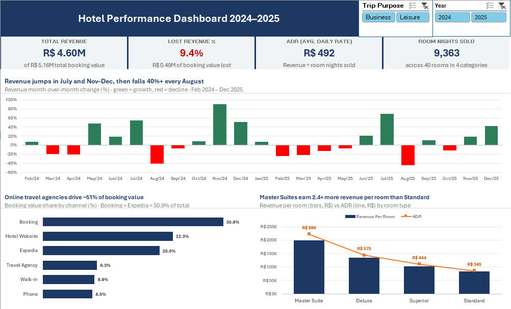
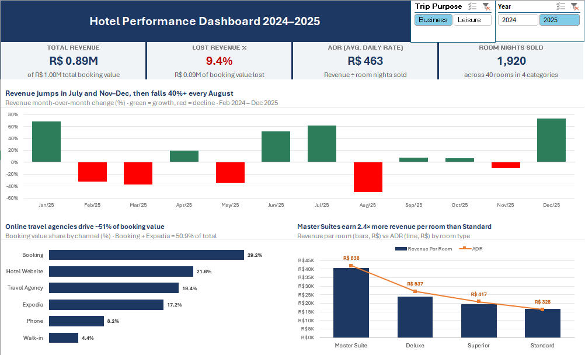
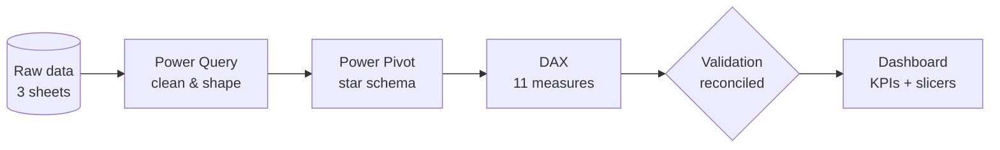
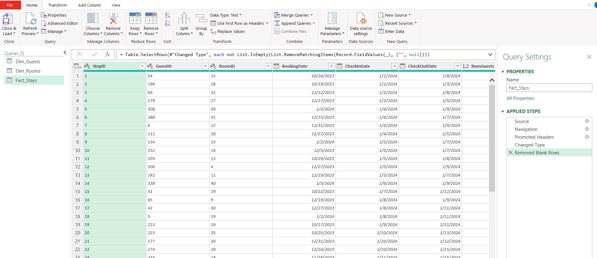
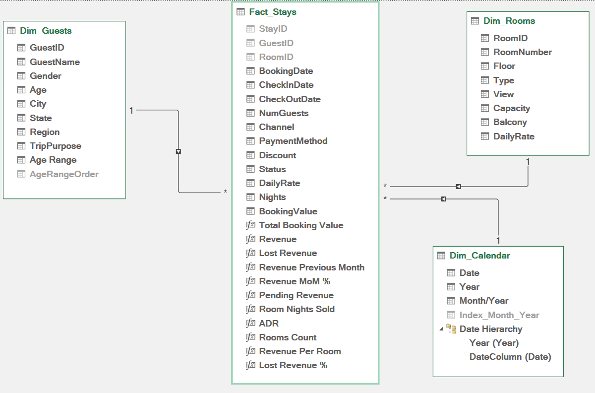
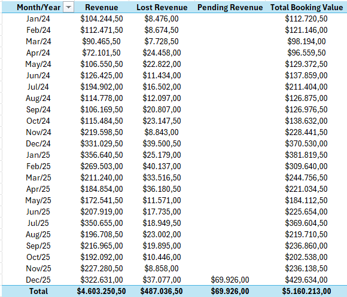

<div align="center">

# 🏨 Hotel Performance Analytics

### From raw booking data to an interactive BI dashboard, built entirely in Excel


**[📊 Dashboard](#-the-dashboard) · [💡 Key insights](#-key-insights) · [🛠️ How it was built](#-how-it-was-built) · [📁 Files](#-repository-structure)**

📑 **[Project presentation (PDF, 15 slides)](Hotel-Performance-Analytics-Deck.pdf)**

</div>

---

## 🎯 The business question

> **Where does the hotel's revenue come from, and where is it leaking?**

| R$ 4.60M | 9.4% | R$ 492 | 9,363 |
|:-:|:-:|:-:|:-:|
| **Total revenue** (2024–2025) | **Lost revenue** (cancellations + no-shows) | **ADR** (average daily rate) | **Room nights sold** |

*Synthetic dataset of a Brazilian hotel: 3,000 stays, 400 guests and 40 rooms in 4 categories, with check-ins from Jan 2024 to Dec 2025. All amounts in Brazilian reais (BRL).*

---

## 📊 The dashboard



One screen answers three questions: **When** does revenue move (month-over-month %), **through which channel** do bookings come, and **which rooms pay off** (revenue per room vs ADR). KPI cards and all charts respond to the **Year** and **Trip Purpose** slicers.

<details>
<summary><b>See it filtered: Business travel, 2025</b></summary>
<br>



With the filter on, travel agencies jump to 19.4% of booking value (vs 5.0% for leisure travel).

</details>

---

## 💡 Key insights

| | Finding | Recommendation to test |
|:-:|---|---|
| 📅 | **Seasonality.** Revenue peaks in July and Nov–Dec, then drops about 40% every August. Revenue grew **+72%** from 2024 to 2025 (R$ 1.69M → R$ 2.91M). | Targeted promotions and staffing plans for low months (August, Feb–May) |
| 🌐 | **Channel mix.** Booking.com and Expedia bring **51%** of booking value. The hotel's own website is already the #2 channel (22%). | Grow direct bookings with website-only perks and rate parity checks |
| 🛏️ | **Room economics.** Each Master Suite earns **2.4×** a Standard room. Master Suites are 12.5% of rooms but 21.6% of revenue. | Test higher premium rates and paid upgrades at booking |
| 💸 | **Revenue leakage.** **R$ 487K** lost to cancellations (R$ 388K) and no-shows (R$ 99K), which is 9.4% of everything booked. | Deposits or non-refundable rates in peak months |
| 💼 | **Business travel.** Travel agencies bring 19.4% of business booking value (vs 5.0% for leisure), and business ADR is lower in every room category. | Review corporate agency agreements and negotiated rates |

<sub>These are hypotheses from the data, to be validated with the commercial team.</sub>

---

## 🛠️ How it was built



<details>
<summary><b>1. Power Query: data preparation</b></summary>
<br>

- Typed every column and removed blank rows
- Renamed queries to a star-schema convention (`Dim_`, `Fact_`)
- Dropped columns not needed for analysis, including personal data (email, birth date)
- Merged Rooms into the fact table to bring in `DailyRate` only
- Derived `Nights` and `BookingValue = DailyRate × Nights × (1 − Discount)`
- Built age bands with a sort-order helper column



➡️ [See the M code](power-query/)

</details>

<details>
<summary><b>2. Power Pivot: star schema</b></summary>
<br>

- One fact table (`Fact_Stays`) and three dimensions (`Dim_Guests`, `Dim_Rooms`, `Dim_Calendar`), all one-to-many, single direction
- Calendar marked as the date table and limited to 2024–2025
- **Modeling decision:** the active relationship uses **CheckInDate**. With CheckOutDate, 27 late-December 2025 stays would have moved into 2026 and dropped out of the yearly totals.
- Months sorted chronologically with a `FORMAT(Date, "YYYYMM")` column
- Tables loaded as connection-only, so no raw data sits on the sheets
- Foreign keys and helper sort columns hidden from client tools (shown in grey below)



</details>

<details>
<summary><b>3. DAX: 11 layered measures</b></summary>
<br>

Every measure builds on one base measure, so each business definition lives in one place:

```dax
Total Booking Value = SUM ( Fact_Stays[BookingValue] )

Revenue      = CALCULATE ( [Total Booking Value], Fact_Stays[Status] = "Completed" )
Lost Revenue = CALCULATE ( [Total Booking Value], Fact_Stays[Status] IN { "Cancelled", "No-show" } )

Revenue MoM % =
    DIVIDE ( [Revenue] - [Revenue Previous Month], [Revenue Previous Month] )

ADR = DIVIDE ( [Revenue], [Room Nights Sold] )
```

➡️ [See all 11 measures](dax/measures.md)

</details>

<details>
<summary><b>4. Validation</b></summary>
<br>

At first, Revenue + Lost Revenue did not equal Total Booking Value. I traced the gap (R$ 69,926) to **Confirmed** bookings, which are future stays at the end of 2025, and created a `Pending Revenue` measure. Now every status reconciles exactly. I also matched row counts to the source (400 / 40 / 3,000) and confirmed the merge matched all 3,000 rows.



</details>

---

## 📚 Lessons learned

- `CALCULATE` needs a measure or an aggregation as its first argument, never a bare column.
- Rename Power Query tables at the query, not in Power Pivot.
- The relationship date decides which period a stay counts in.
- When totals don't reconcile, the gap is usually a finding.

## 🔭 Next steps

- Add Occupancy % and RevPAR measures
- Booking-date analysis with an inactive relationship and `USERELATIONSHIP`
- Rebuild the model in Power BI as part of PL-300 preparation

---

## 📁 Repository structure

```
├── Hotel Performance Analytics.xlsx       # Workbook: queries, data model, measures, dashboard
├── Hotel_Database.xlsx                    # Source data (synthetic)
├── Hotel-Performance-Analytics-Deck.pdf   # Project presentation (15 slides)
├── power-query/                           # M code for each query
├── dax/measures.md                        # All DAX measures
└── images/                                # Screenshots used in this README
```

**To explore it:** download the workbook and open it in Excel for Windows (Power Pivot is not available on Mac or Excel Online; the *Data Model* sheet shows the diagram and measures for those viewers). To refresh, open *Data → Queries & Connections* and point each query's source path to your local copy of `Hotel_Database.xlsx`.

---

<div align="center">

**Matheus Ribeiro** · PMP · MBA, Duke University

[](https://github.com/matheusaribeiro)

</div>
